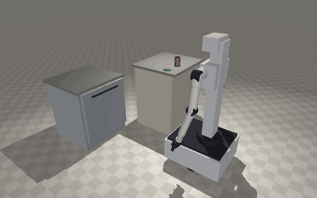

# Robot Simulator

An interactive 3D simulator of a humanoid mobile manipulator: a wheeled base, a lift column with a torso that rides up and down it, a camera head, and two 7-joint arms. Drive it around a warehouse floor, pose the arms joint by joint, or drag a target and let inverse kinematics move the hand there. Each joint shows its angle, speed and the torque its motor needs to hold the arm against gravity.

**Stack:** React + TypeScript + Tailwind, with three.js for the 3D view. Everything runs in the browser; there is no server.

## What you can do

| Panel | What it does |
| --- | --- |
| **Arms · Joints (FK)** | Move all 7 joints of either arm (or both, mirrored) with sliders inside their limits, open and close the gripper, or pick a preset pose (Ready, Rest, Reach, Carry, Arms up, T-pose). **Wave** waves the right arm. |
| **Arms · Reach (IK)** | Drag the arrows on the hand target, set it with sliders, or click a crate, barrel or the floor. The solver moves the arm so the fingertips reach it, optionally with the fingers pointing forward or down. It shows whether the target was reached, the remaining error, iterations and solve time. Out-of-reach targets get the closest pose, with a red dashed line to the target. |
| **Joints table** | Angle within limits, speed, and gravity holding torque against the motor's rating, live for the selected arm, plus the hand position. A **payload** slider puts weight in the hand. |
| **Tasks** | Four stations around the floor. **Sort blocks** (by colour into bins; the hand nearest each block picks it and turns at the waist to reach its bin), **Load dishwasher** (open the door, pull out the racks, load plates and cups, close everything and press start), **Fold shirt** (sides in one hand at a time, then the bottom up with both hands) and **Wash clothes** (lift the lid, move clothes from the basket into the drum, close it and press start). The robot drives to each station and docks; shows progress and a step log; runs at 1x to 8x; **Reset scene** puts everything back. |
| **Drive** | WASD / arrow keys or the on-screen pad, or click the floor to send the robot there. Crates and barrels block it. The camera can follow the robot. |
| **Torso** | Shoulder height on the column (78 to 118 cm) and the waist: the column, torso, arms and head turn together on a turntable on the base (±100°). In Reach mode and during tasks the waist turns by itself toward the work. |
| **Head** | Looks where the robot is going, at the IK target, or around when idle; or pan and tilt it by hand. |

## The robotics

* **Waist:** a vertical joint where the column meets the base turns the whole upper body. The arm kinematics start from the turned torso frame (`torsoBase`). For each move the waist angle is chosen so the working shoulder(s) end up about 42 cm (horizontally) from their targets, with a mild preference for facing straight ahead (`waistFor`), and the arms' IK solves the rest.
* **Arm chain:** shoulder pitch, shoulder roll, upper-arm twist, elbow, forearm twist, wrist pitch, wrist yaw (7 joints), then a two-finger gripper. One table in `src/lib/kinematics.ts` gives each joint's position in the previous joint's frame, its axis, limits, motor speed and acceleration, rated torque and the mass of the link after it. The 3D model, forward kinematics, IK and torques are all built from that table. The left arm is the right arm mirrored.
* **Realistic joints:** every joint is a rotary actuator on its real axis: a finned motor housing, an aluminium output flange with bolts, an end cap, cables, clevis brackets at the elbow and wrist, and a status LED that turns amber at half its rated torque and red near the limit. Joints (and the lift and head) follow targets with a **trapezoidal velocity profile**: they accelerate, cruise at their top speed, then brake to stop exactly on target.
* **Forward kinematics:** chain the joint transforms `T = base · Π Trans(offsetᵢ) · Rot(axisᵢ, qᵢ) · Trans(tool)`.
* **Jacobian:** for a revolute joint, column `i` is `aᵢ × (p_tool − pᵢ)` for position and `aᵢ` for orientation, with `aᵢ` and `pᵢ` the joint's world axis and position.
* **Inverse kinematics (damped least squares):** `dq = Jᵀ(JJᵀ + λ²I)⁻¹ e`, where `e` is the position error (and, if requested, the error in the fingers' pointing direction). Seven joints is more than a hand position needs, so the spare freedom (null space) pulls the arm toward a natural rest pose: `dq += (I − J⁺J)·k·(q_rest − q)`. Joints pinned at a limit are frozen so the others take over, and if a solve gets stuck it retries from a few start poses. On random reachable targets it succeeds 100% of the time in about 0.3 ms.
* **Tasks:** each task is planned from the current scene as a list of steps (drive and dock, set the lift, IK moves, gripper, grab, release, hold a mechanism). Grasps fix the whole hand orientation (which way the fingers point and which way they close). Far targets tilt the hand toward the target, since pointing straight down costs reach. Doors, racks, the washer lid and the shirt folds follow the hand that holds them; released items drop into their bin, rack slot or drum under physics. The base checks its full rectangular footprint against the furniture.
* **Natural motion:** every reach is a straight-line hand path cut into ~3 cm steps, each solved from the previous one, so the arm never flips to a different configuration on the way. The spare (7th) degree of freedom is spent changing as little as possible between steps, so the forearm and wrist never twist against each other. All joints of an arm are time-scaled to start and finish each step together. The elbow, wrist and palm are constrained to stay above the work surface (only the fingertips reach down to an item), and between items the arms wait in a ready pose above the table edge.
* **Physics (live, in the browser):** [Rapier](https://rapier.rs), compiled to WebAssembly, steps at 120 Hz (`src/components/physicsWorld.ts`). Blocks, plates, mugs and clothes are rigid bodies with mass and friction: they fall, stack, tip over, ride on the racks and tumble in the spinning drum. The robot's base, column, torso, arm links and palms, and the dishwasher door and racks and washer lid and drum, are kinematic bodies that follow the controller and push items aside. A grasp holds only if the item is really between the fingers when the hand closes; letting go drops it, and an item that lands on the floor goes back on the to-do list. Round items use convex hulls (Rapier's cylinder primitive is unstable against thin posts). Held items stop colliding with other items, and the tasks take a pile from the top down.
* **Cloth (live):** the T-shirt is simulated cloth (`src/components/clothSim.ts`): position-based dynamics on a 23 × 51 particle grid (the ~860 inside the T-shirt outline are simulated), with stretch, shear and bending constraints (bending resists only stretching, so a fold lies flat instead of springing back), gravity, table contact with position-based static friction, and self-collision through a spatial hash with friction between layers. Each scene reset drops the shirt into a different crumpled heap (picked up by one point, swung and let go). The fold task then works the way laundry robots do: it finds the shoulders, takes one in each hand (without turning the waist while holding), raises the torso so the shirt hangs open, lowers it until the hem touches the table and lays it down flat at full length by moving the hands forward exactly as fast as down. It then folds each side in from the sleeve and the bottom up with both hands pinching the hem through all its layers. Every grasp is planned when it starts, from where the cloth lies at that moment, and only holds if the fingertips are within 4 cm of the point. Folding arcs leave a little slack so the flap doesn't drag the rest of the shirt. While the cloth moves, the whole scene slows rather than the cloth taking coarse steps.
* **Gravity torque:** each motor holds `τᵢ = −aᵢ · Σ (p_m − pᵢ) × m·g` over every link (and payload) further down the arm.
* **Base:** differential drive with acceleration limits; it turns toward a clicked goal, then drives, slowing on arrival.

## Run locally

Requires Node 20+.

```bash
cd frontend
npm install
npm run dev
```

Then open http://localhost:5173.

## Physics simulation

`physics/` runs the same robot in [MuJoCo](https://mujoco.org) with real mass, torque limits, contact and friction. It generates MJCF and URDF models from the web app's joint table, checks them, and runs a pick-and-place and a dishwasher-opening task. See [physics/README.md](physics/README.md).



## Deploy

`render.yaml` deploys to [Render](https://render.com) (**New → Blueprint**, pick this repo). The `Dockerfile` builds the front end and serves it with nginx (config in `deploy/`), with `/api/health` for Render's health check. Any static host also works: `npm run build` writes the site to `frontend/dist`.

## Project layout

```
frontend/src/
  App.tsx                    page header + simulator
  components/Humanoid.tsx    3D scene, robot model, driving, arm control, panels
  components/ui.tsx          cards, sliders, buttons
  components/stationProps.ts 3D models of the stations, items and moving parts
  lib/kinematics.ts          joint table, FK, Jacobian, IK, gravity torques
  lib/stations.ts            station layout, furniture, items, door/rack/lid/fold geometry
  lib/tasks.ts               task planners (sort, dishes, fold, wash)
  lib/math.ts                helpers and the trapezoidal motor profile
physics/
  build_models.py            ARM table -> MJCF + URDF models
  check_models.py            model quality checks
  demo.py                    MuJoCo pick-and-place and dishwasher demo
```
