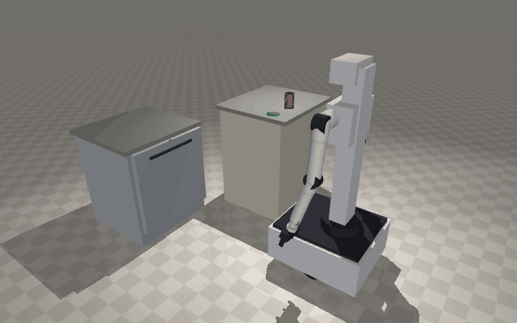
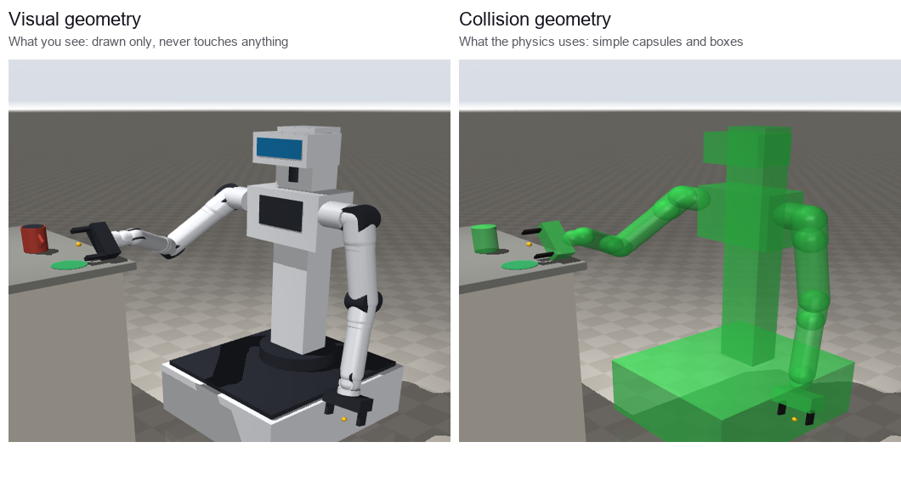

# Physics simulation (MuJoCo)

The web simulator moves the arms exactly where the kinematics say, and a grasped item is attached to the hand. This folder runs the **same robot with real physics** in [MuJoCo](https://mujoco.org): motors have torque limits, parts have mass, and objects are held only by grip force and friction.



## What's here

| File | What it does |
|---|---|
| `build_models.py` | Reads the `ARM` table in `frontend/src/lib/kinematics.ts` and writes the models below, so the physics robot always matches the web app |
| `models/robot.xml` | The robot in MJCF, MuJoCo's format |
| `models/robot.urdf` | The same robot in URDF, which Drake, Isaac Sim and ROS read |
| `models/scene.xml` | Kitchen: the robot, a counter with a cup, and a dishwasher with a sprung, damped door |
| `check_models.py` | 15 checks: the files compile, the limits match the web app, everything has mass and collision shapes, nothing overlaps at the start |
| `demo.py` | The robot picks up the cup and opens the dishwasher, then reports what happened |

## Run it

Requires Python 3.10+.

```bash
cd physics
pip install -r requirements.txt
python build_models.py     # regenerate the models after changing kinematics.ts
python check_models.py     # model checks
python demo.py             # run both tasks headless and print a report
python demo.py --view      # watch it in the MuJoCo viewer
python demo.py --record    # save media/demo.gif and still images
```

To explore the scene by hand, run `python -m mujoco.viewer --mjcf=models/scene.xml`. Press `3` to show the collision shapes, and double-click a part and drag it with Ctrl+right-click to push it.

## How it works

**One source of truth.** Each arm joint's position, axis, limits, rated torque and mass come from the web app's `ARM` table. The web app is y-up and MuJoCo is z-up, so a point `(x, y, z)` becomes `(x, -z, y)`.

**Visual vs. collision geometry.** Every part has detailed shapes for drawing, which never touch anything, and simple capsules and boxes the physics engine uses.



**The control loop.** Every 10 ms:
1. The task script sets a target for the base, the lift and each hand.
2. Inverse kinematics (damped least squares on MuJoCo's Jacobian) turns each hand target into seven joint angles.
3. Position servos drive the joints, limited to each motor's rated torque.
4. MuJoCo steps the physics five times (2 ms each): torques, gravity, contact and friction.

**The tasks.**
- **Cup:** The hand comes in over the counter edge with the fingers tilted 30° down, closes with up to 40 N, lifts, carries the cup to the mat and lets go. Nothing attaches the cup; if the grip were too weak, it would slip.
- **Dishwasher:** The door is a hinge with a counterbalance spring and damping. The hand grabs the handle and pulls the door along its arc to about 35°. It then lets go, goes over the top edge, and presses the door down while the base backs away. Gravity takes the door the rest of the way.

**What the report measures:**
- cup slip in the hand
- peak grip force
- where the cup landed
- the door's final angle
- any contact between the robot and the furniture that the task did not plan

`demo.py` exits with code 1 if any check fails.

## Simplifications

- The base slides on the floor (x, y, heading) instead of rolling on wheels. Mobile manipulators are usually simulated this way when wheel slip isn't being studied.
- The fingers are parallel sliders, not the web app's pivoting fingers.
- Arm links compensate for their own weight (`gravcomp`), as a real arm's controller does. The motors still carry the cup and push on the door.
